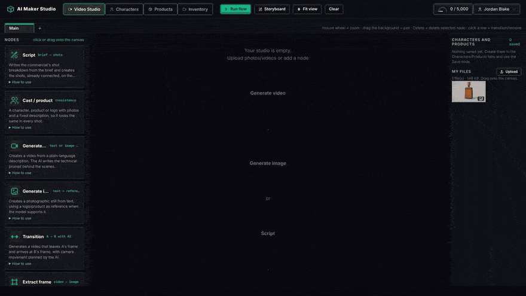
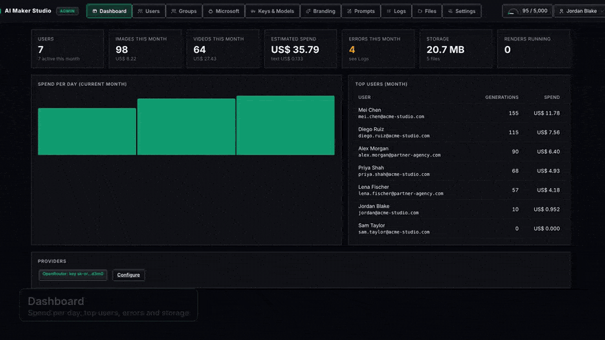

<div align="center">

# AI Maker Studio

**Make AI commercials and short films on a node canvas.**
Script → cast → frames → video → final cut, with the same character and product in every shot.
Self-hosted, multi-model through [OpenRouter](https://openrouter.ai), no GPU required.

[](https://github.com/sorakes/AI-MAKER-STUDIO/actions/workflows/ci.yml)
[](https://github.com/sorakes/AI-MAKER-STUDIO/pkgs/container/ai-maker-studio)
[](https://github.com/sorakes/AI-MAKER-STUDIO/releases)
[](LICENSE)

[](https://github.com/sorakes/AI-MAKER-STUDIO/stargazers)

[Quick start](#quick-start) · [Features](#features) · [For teams](#for-teams-admin-panel) · [Configuration](#configuration) · [Português](README.pt-BR.md)



<sub><a href="docs/presentation.mp4">▶ Watch in HD</a></sub>

</div>

## Why

Hosted AI video tools lock you into one vendor's models, credits and canvas. AI Maker Studio gives you the same kind of node-based workflow **on your own server**, with **any image and video model on OpenRouter** (Kling, Seedance, MiniMax Hailuo, Wan, Gemini, Nano Banana and more) behind a single API key.

- 🎬 **Think in shots, not prompts.** Write what should happen in plain language; the studio writes the technical prompt from your intent, the camera you drew, the references and the brand.
- 🧍 **Consistent cast and products.** Build a character or product sheet once (8 poses/views, spritesheet) and it looks the same in every shot.
- 🔗 **Shots that connect.** An image wired into a video becomes its first frame; a video wired into the next one continues from its last frame. Transitions go from A's frame to B's.
- 🎥 **Direct the camera by drawing.** Sketch the camera route on the first frame; a vision model reads it and turns it into camera direction.
- ✂️ **Finish the cut.** Final edit with ffmpeg: cuts, editorial transitions, music and voice-over.
- 💻 **No GPU.** Everything runs through the OpenRouter API. A small VPS is enough.

## Quick start

```bash
docker run -d --name ai-studio -p 3000:3000 -v studio-data:/data \
  ghcr.io/sorakes/ai-maker-studio:latest

docker logs ai-studio | grep -i password   # first admin password
```

Open `http://localhost:3000`, sign in as `admin@local`, and paste your OpenRouter key in **Admin → Keys & Models**. One key covers text, vision, image and video.

For production (fixed `SECRET_KEY`, your own admin account, video editing tunnel), use [Docker Compose](#run-with-docker-compose).

## Features

**Studio** (`/`, after signing in)

- Connected nodes: script, cast/product, image, video, transition, frame, approval and edit.
- Chrome-like tabs inside each area (Video Studio, Characters, Products), plus an **Inventory** to browse, bulk-delete and send files to any node.
- Each image/video/transition node picks a **model** among the ones the admin enabled. **Automatic** chooses the default that fits the connection (text→video, image→video, first + last frame, references).
- **Multi-reference video**: recommended models receive the frame, cast, product and camera drawing together with the text (tested model by model). The node warns when a model ignores references or when there are more references than it accepts.
- Camera direction drawn on the first frame (purple = camera route, other colors = elements), read by a vision model and written into the prompt.
- **Edit video** with video-editing models (FLUX Video Edit, Runway Aleph, Wan, Seedance) and region editing (inpaint) on images.
- A token gauge next to the profile shows how much of the monthly budget is used.

**Characters and Products**

- Character/product sheet (fixed description + attributes), references with notes, generation of 8 poses/views, spritesheet, and a library used by the **Cast / product** node.

**Languages**

- The interface ships in **English** (default), **Português** and **Español**. Each person picks a language in the profile menu or on the sign-in page. The AI writes its notes, titles and suggestions in the interface language.

## For teams (admin panel)

Built to be shared by an agency or a marketing team, with every person in their own workspace. The admin panel lives at `/admin`:




- **Users and groups** with base permissions (areas, image/video generation, AI assistants, upload/delete, admin) and per-node permissions. Accounts in several groups get the sum of permissions and the most generous limit.
- **Token budget per group**: set a monthly amount in US$, either "each person gets this amount" or "split among members". People only ever see tokens.
- **Microsoft sign-in (Entra ID)** with automatic group assignment by email domain, Entra group, app role or tenant.
- **Keys & Models**: the OpenRouter key is always stored encrypted (Fernet, derived from `SECRET_KEY`); the browser only gets a mask (`sk-or…1234`). Models are added from the OpenRouter catalog with type, capabilities, durations and price detected automatically.
- **Branding** (name, logo, colors, pixel or rounded style), editable **Prompts**, **Logs** with CSV export, **Files** and a **Dashboard**.

## Run with Docker Compose

```bash
git clone https://github.com/sorakes/AI-MAKER-STUDIO.git && cd AI-MAKER-STUDIO
cp .env.example .env
# edit .env: SECRET_KEY (required in production), ADMIN_EMAIL, ADMIN_PASSWORD
python -c "import secrets; print(secrets.token_urlsafe(48))"   # generates a SECRET_KEY

docker compose up -d --build
```

Data (SQLite database + user files) lives in the `studio-data` volume (`/data` inside the container).

**Edit video** needs the `tunnel` service (a Cloudflare quick tunnel, no account, started by `docker compose`). Video-editing models only accept the source video as a public HTTPS link, so the app hands out one temporary link per clip: `/pub/<token>/<file>`, revoked as soon as the result arrives (or after 45 min). Through the tunnel **only** `/pub/` answers; the studio, login, API and `/files` return 404. Without the tunnel the node says so and does not edit. Set `TUNNEL_HOST` to use a named tunnel with a fixed domain instead. **Keys & Models → Required models per feature** shows what each node needs and whether it is covered.

**Backup:** copy the volume. The database alone does not expose the keys: without the `SECRET_KEY` they cannot be decrypted. Keep the `SECRET_KEY` somewhere else.

## Run without Docker

Requires Python 3.12+ and `ffmpeg`/`ffprobe` on the PATH.

```bash
pip install -r requirements.txt
export SECRET_KEY=... ADMIN_EMAIL=admin@example.com ADMIN_PASSWORD=...
uvicorn app.main:app --port 3000
```

## Configuration

All settings come from environment variables (see `.env.example`):

| Variable | Default | What it does |
|---|---|---|
| `SECRET_KEY` | generated in the data folder | Encrypts the API keys stored in the database. Set it in production. |
| `ADMIN_EMAIL` / `ADMIN_PASSWORD` | `admin@local` / random (printed in the log) | First administrator, created only if there is no admin yet. |
| `APP_NAME` | `AI Studio` | Name on the sign-in page and in the studio (can be changed in Branding). |
| `PUBLIC_URL` | `http://localhost:3000` | Public address (OpenRouter referer and Microsoft redirect). |
| `PORT` | `3000` | Port published on the host. |
| `COOKIE_SECURE` | `0` | `1` = session cookie only over HTTPS (use behind a TLS proxy). |
| `DATA_DIR` | `./data` (`/data` in Docker) | Database and user files. |
| `OPENROUTER_API_KEY` | — | Optional: key from the environment instead of the panel. |
| `SESSION_DAYS`, `MAX_UPLOAD_MB` | `14`, `200` | Session length and upload size limit. |

## Microsoft sign-in (Entra ID)

1. In Azure: Entra ID → App registrations → New registration. As Redirect URI (Web) use `<public address>/api/auth/microsoft/callback`. The panel shows the exact address, ready to copy.
2. Create a client secret and fill in Tenant, Client ID and Client secret in the panel (Microsoft tab). The secret is stored encrypted, like the API keys.
3. To assign groups automatically, enable the groups claim in the token or use App roles, then add rules to each group: email domain, Entra group ID, app role or tenant. Automatic groups are recalculated on every sign-in; manually assigned groups stay.

The flow is OpenID Connect with PKCE, and the id_token is validated: RS256 signature against Microsoft's public keys, issuer, audience, expiry and nonce. Existing accounts are only linked by email when the Tenant is a fixed ID. In production use HTTPS and `COOKIE_SECURE=1`.

## Adding a language

UI texts are translated by `static/js/i18n.js` using dictionaries keyed by the original text:

- `static/js/i18n-en.js`: English.
- `static/js/i18n-es.js`: Spanish, keyed by the English text. Anything missing falls back to English.

To add a language, copy `i18n-es.js`, translate the values, register the code in `LANGS` inside `i18n.js` and add the `<script>` tag to the three HTML pages. Opening the app with `localStorage.i18n_debug = '1'` and running `I18N.missing()` in the console lists any text still untranslated. New languages are a great first contribution, see [CONTRIBUTING.md](CONTRIBUTING.md).

## Known limitations

**Region editing (inpaint) with chat-based image editors.** The painted region is replaced by a chat-based editing model. It works well with simple, isolated objects and struggles with thin, overlapping ones (wings, hair, fences): the model reinterprets the area instead of erasing it. Tested in November 2026 with the same image and mask:

| Model | Result | Cost per attempt |
|---|---|---|
| Google Nano Banana 2 Lite (default) | wings redrawn, not removed (3 attempts, with and without vision) | ~US$ 0.034 |
| Google Nano Banana Pro | wings still visible | ~US$ 0.139 |
| OpenAI GPT-5 Image | returns no image on this route | not charged |

To remove something thin or overlapping, also paint a bit of the background around it and describe what should appear in its place.

## Development and tests

```bash
pip install -r requirements-dev.txt   # production + pytest + httpx
python -m pytest -q                    # full suite (~10 s, no network, no ffmpeg)
```

- `tests/conftest.py` creates a temporary `DATA_DIR` and sets test `SECRET_KEY`/`ADMIN_PASSWORD` before importing the app, so nothing touches your `data/`.
- Media, providers and Microsoft are mocked (`ffmpeg`, HTTP and RS256 tokens generated in the test). Download tests start a local HTTP/HTTPS server.
- CI (`.github/workflows/ci.yml`) runs the same suite on Python 3.12 on every push and pull request.

<details>
<summary>Project layout</summary>

```
app/
  main.py         page routes (/login, /, /admin), startup, request language
  config.py       environment variables
  db.py           SQLite (users, sessions, providers, models, usage, jobs, canvas)
  security.py     scrypt (passwords), session tokens, Fernet (keys)
  auth.py         sign-in, session, current user, default limits
  groups.py       groups, permissions (base + nodes), automatic rules, tokens
  microsoft.py    Microsoft sign-in (OIDC + PKCE, id_token validation)
  usage.py        usage logs and limit checks
  storage.py      per-user isolated files (/files/<id>/...)
  providers.py    OpenRouter (encrypted keys, HTTP, catalog, pricing)
  registry.py     models: catalog → capabilities, reference limits, request body
  jobs.py         render queue (image/video steps, resumes after restart)
  llm.py          text/vision with the default model
  promptgen.py    technical prompt + camera path analysis
  transitions.py  A→B transition planning
  montage.py      final cut (ffmpeg)
  routers/        auth, studio, admin
static/           login.html, studio.html, admin.html, css, js (i18n*.js = translations)
```

</details>

## Security

- Passwords hashed with scrypt. The session is an HttpOnly, SameSite=Lax cookie. For HTTPS, set `COOKIE_SECURE=1`.
- Sign-in attempts are rate limited per IP + email.
- Each file only opens for its owner (or an admin). Paths with `..` and access to another user's folders are refused.
- API keys are never returned by the API; only the mask leaves the server.
- To expose it on the internet, put it behind a TLS proxy (Caddy, Traefik, Nginx).

Found a vulnerability? Please report it privately, see [SECURITY.md](SECURITY.md).

## Contributing

Issues and pull requests are welcome. Good places to start: new interface languages, model compatibility reports and documentation. See [CONTRIBUTING.md](CONTRIBUTING.md).

If AI Maker Studio is useful to you, a ⭐ helps other people find it.

## Credits

- Icons: [Pixelarticons](https://pixelarticons.com) by Gerrit Halfmann, MIT license (embedded in `static/js/icons.js`).

## License

[MIT](LICENSE)
