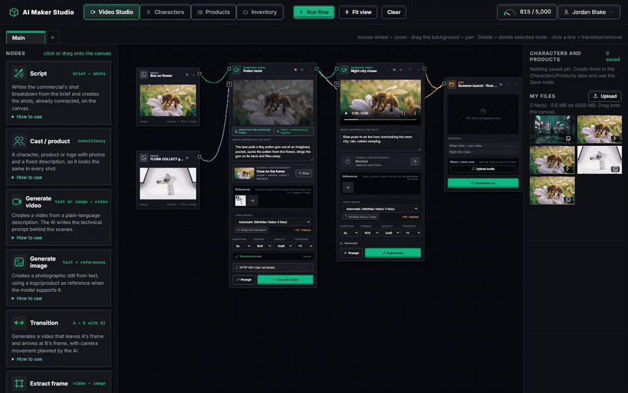

<div align="center">

# AI Maker Studio

**Crie comerciais e curtas com IA num canvas de nós.**
Roteiro → elenco → frames → vídeo → montagem final, com o mesmo personagem e produto em todas as cenas.
Self-hosted, vários modelos via [OpenRouter](https://openrouter.ai), sem precisar de GPU.

[](https://github.com/sorakes/AI-MAKER-STUDIO/actions/workflows/ci.yml)
[](https://github.com/sorakes/AI-MAKER-STUDIO/releases)
[](LICENSE)

[English](README.md) · **Português**



</div>

## Por quê

As ferramentas de vídeo com IA hospedadas prendem você aos modelos, créditos e canvas de um único fornecedor. O AI Maker Studio entrega o mesmo tipo de fluxo em nós **no seu próprio servidor**, com **qualquer modelo de imagem e vídeo do OpenRouter** (Kling, Seedance, MiniMax Hailuo, Wan, Gemini, Nano Banana e outros) usando uma única chave de API.

- 🎬 **Pense em cenas, não em prompts.** Descreva o que acontece em linguagem simples; o studio escreve o prompt técnico a partir da sua intenção, da câmera desenhada, das referências e da marca.
- 🧍 **Elenco e produtos consistentes.** Monte a ficha de um personagem ou produto uma vez (8 poses/vistas, spritesheet) e ele aparece igual em todas as cenas.
- 🔗 **Cenas que se conectam.** Uma imagem ligada a um vídeo vira o primeiro frame; um vídeo ligado ao próximo continua do último frame. Transições vão do frame de A ao de B.
- 🎥 **Dirija a câmera desenhando.** Rabisque o trajeto da câmera no primeiro frame; um modelo de visão lê o desenho e transforma em direção de câmera.
- ✂️ **Feche a montagem.** Edição final com ffmpeg: cortes, transições, trilha e locução.
- 💻 **Sem GPU.** Tudo roda pela API do OpenRouter. Uma VPS pequena dá conta.

## Começo rápido

```bash
docker run -d --name ai-studio -p 3000:3000 -v studio-data:/data \
  ghcr.io/sorakes/ai-maker-studio:latest

docker logs ai-studio | grep -i password   # senha do primeiro admin
```

Abra `http://localhost:3000`, entre como `admin@local` e cole sua chave do OpenRouter em **Admin → Keys & Models**. Uma chave cobre texto, visão, imagem e vídeo.

Para produção (`SECRET_KEY` fixa, conta de admin própria, túnel para edição de vídeo), use o Docker Compose:

```bash
git clone https://github.com/sorakes/AI-MAKER-STUDIO.git && cd AI-MAKER-STUDIO
cp .env.example .env   # preencha SECRET_KEY, ADMIN_EMAIL, ADMIN_PASSWORD
docker compose up -d --build
```

## Para times

O painel em `/admin` controla usuários e grupos com permissões por área e por nó, orçamento mensal de tokens por grupo, login Microsoft (Entra ID) com atribuição automática de grupos, chaves de API sempre criptografadas, catálogo de modelos do OpenRouter, branding, prompts editáveis, logs com exportação CSV e dashboard.

A interface vem em **inglês**, **português** e **espanhol**, e a IA escreve notas e sugestões no idioma escolhido.

## Documentação completa

Configuração, variáveis de ambiente, login Microsoft, edição de vídeo, segurança, testes e estrutura do projeto estão no [README em inglês](README.md).

## Contribuindo

Issues e pull requests são bem-vindos. Bons pontos de partida: novos idiomas, relatos de compatibilidade de modelos e documentação. Veja o [CONTRIBUTING.md](CONTRIBUTING.md).

Se o projeto for útil pra você, uma ⭐ ajuda outras pessoas a encontrá-lo.

## Licença

[MIT](LICENSE)
